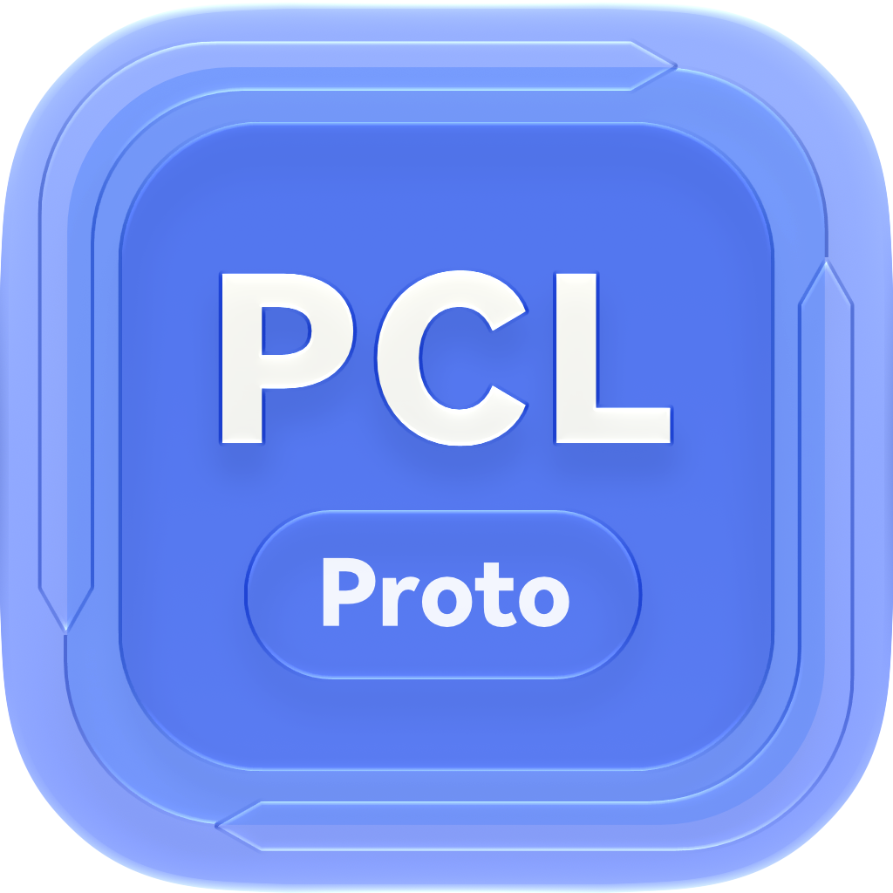
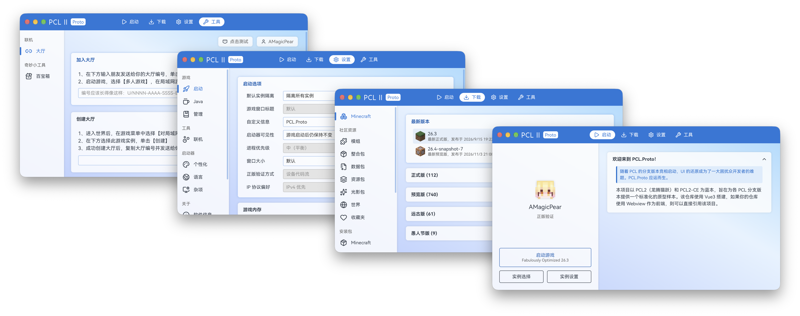

# PCL.Proto

| [中文版点我](./README-CN.md) |

<p align="center">
  
</p>

With the rapid launch of PCL branch versions, UI restoration has become a major challenge for many developers. PCL.Proto emerges as a solution.



This project is modeled after [PCL2](https://github.com/Hex-Dragon/PCL2) and [PCL2-CE](https://github.com/PCL-Community/PCL2-CE), with a goal of providing a standardized prototype sample for each PCL branch version. The repository is built using Vue3, and if your project uses Webview as the frontend, you can directly reference this project.

The project is also ready for preview at [PCL.Proto](https://amagicpear.top/PCL.Proto/).

The website and desktop client are maintained together on `main`. Browsers show the project introduction, launcher preview, and interactive component demos on the home page. The PCL homepage editor is also available from the toolbox. The desktop client shows only the launcher.

Run `bun run deploy` to check, build, and publish the website to `origin`'s `gh-pages` branch.

## Prototype

If your PCL branch version or your custom launcher is not based on Web technology, referencing this repository directly might have limited convenience. You may head to [js.design - 「PCL.Prototype」](https://js.design/f/QVPQRY?p=zX2rcVk6Cy&mode=design) to view the specific application prototype, export the cut image or refer to the style code generated by it.

In case you would like to modify the prototype design file, you are welcome to [click this link](https://js.design/ti?c=tS-6qs0WDQJ3H4) to join the team.

## Project Configuration

### Prerequisites

- Install Bun 1.4.4 or later. The project uses Bun for package management, scripts, formatting, and UI checks.
- The device should have a usable rust toolchain installed.

### Platform Specific

- Windows: the MSVC toolchain, C++ development tools, and Windows SDK are required. Run `bun run setup:windows` to prepare the Protobuf compiler and WinDivert driver. Npcap is no longer a build dependency; the launcher installs it on demand the first time multiplayer is used. The Tauri WebView2 runtime is assumed to be present.
- macOS: make sure that Xcode is installed. You also need to install protobuf via Homebrew (`brew install protobuf`).
- Ubuntu: you need to install the following packages: `libwebkit2gtk-4.0-dev libwebkit2gtk-4.1-dev libappindicator3-dev librsvg2-dev patchelf protobuf-compiler`.

> [!NOTE]
> If you have any questions, please refer to [Prerequisites | Tauri](https://tauri.app/start/prerequisites/).

### Project Dependencies

After cloning this project, you need to run the following command to initialize the submodule:

```sh
git submodule update --init --recursive
```

Currently, the project is a Tauri + Vue3 + Vite project. Before running the project for the first time, please run the following command to install the front-end dependencies:

```sh
bun install --frozen-lockfile
```

The backend dependencies will be managed by `cargo` automatically.

Then, use `bun run icons` to automatically generate icons. You can then start the development and build processes.

> [!WARNING]
> The icons in this repository are excluded. Therefore, if you do not perform this step after cloning the repository, the `icons` folder will be empty, and the Tauri application will throw an error when it starts!

### Hot Reload Development

```sh
bun run dev
```

> [!NOTE]
> The CurseForge resource source needs an API key: set `CURSEFORGE_API_KEY` in the environment or in the git-ignored root `.env` before building. The key is embedded in the desktop binary, with a runtime environment fallback. Without it CurseForge is unavailable; the web preview cannot use it.

> [!NOTE]
> Microsoft login requires a Microsoft OAuth client ID and has no built-in default: the old public client ID is rejected by the Microsoft device-code endpoint, so login fails with `configuration_error` when unset. Set `MS_CLIENT_ID` in the build environment or the git-ignored root `.env`, or set `MS_CLIENT_ID` / `PCL_MS_CLIENT_ID` at runtime. The Azure app registration must support the device-code flow and the `XboxLive.signin offline_access` scope, and must be approved at <https://aka.ms/mce-reviewappid>; otherwise `login_with_xbox` returns 403.

### Build Tauri App

See [Application packaging](docs/PACKAGING.md) for the macOS bundle layout. Distribute
the complete `.app` or DMG.

Tauri's development and build hooks use Bun directly.

## Vue Components

The reusable controls are packaged as `@amagicpear/pcl-proto-components`. See the [component package guide](packages/components/README.md) for imports, styling, locale, and licensing. To build a local npm package, run `bun run components:build` followed by `npm pack ./packages/components`. Publishing requires access to the npm scope and is a separate step.

## Rust Core

The launcher core is a standalone crate at `crates/pcl-core`, usable to build another launcher:

```toml
[dependencies]
pcl-core = { git = "https://github.com/PCL-Community/PCL.Proto", rev = "<commit>" }
```

See the [core crate guide](crates/pcl-core/README.md) for explicit HTTP clients, credentials,
launch inputs, and the built-in installation and launch helpers.

## Credits

> If I have seen further it is by standing on ye shoulder of Giants.
> —— Sir Isaac Newton

### Directed referenced projects

- [Vue.js](https://github.com/vuejs/core)
- [TypeScript](https://github.com/microsoft/TypeScript)
- [Pug](https://github.com/pugjs/pug)
- [Vite](https://github.com/vitejs/vite)
- [Vue Router](https://github.com/vuejs/vue-router-next)
- [xml-js](https://www.npmjs.com/package/xml-js)
- [Pinia](https://pinia.vuejs.org/)
- [skinview3d](https://github.com/bs-community/skinview3d)
- [Bun](https://bun.com/)
- [Rust Programming Language](https://www.rust-lang.org/)
- [Tauri](https://tauri.app/)
- [Terracotta](https://github.com/burningtnt/Terracotta)

### Implementation or design reference

- [Plain Craft Launcher](https://github.com/Meloong-Git/PCL)
- [PCL2-CE](https://github.com/PCL-Community/PCL2-CE)
- [PCL.Neo](https://github.com/PCL-Community/PCL.Neo)
- [xphost008/MMCLL](https://github.com/xphost008/MMCLL)
- [Steve-xmh/scl](https://github.com/Steve-xmh/scl)

### Localization

[应用多语言方案与文案约定](docs/DEVELOPMENT.md#应用多语言)

[Code organization and maintenance boundaries](docs/ARCHITECTURE.md)
